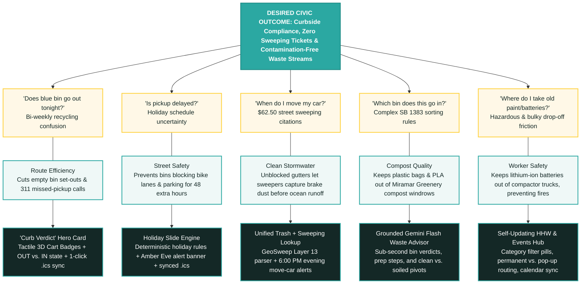

# CurbDay SD 🚛🏄
### *Modernizing Municipal Sanitation & Street Sweeping for 1.4M San Diegans*

> *"Wheels in, surf’s up"* 🏄

[](https://curbday-sd.vercel.app/)
[](https://curbday-sd.vercel.app/case-study)
[](LICENSE)
[](https://nextjs.org/)
[](https://supabase.com/)
[](https://ai.google.dev/)

> [!IMPORTANT]
> **Civic Project Notice:**  
> *Independent civic project; not an official City of San Diego Environmental Services Department (ESD) application. Built in good faith using publicly accessible municipal data with respectful edge caching to help San Diego residents comply with local sanitation, recycling, and hazardous waste regulations.*

---

## The Problem

San Diego municipal curb data is fragmented across disconnected, desktop-era tools:
- **Curbside Collection ([CollectionMapLookup](https://getitdone.sandiego.gov/CollectionMapLookup)):** Returns raw unformatted database timestamps (`"Trash: Fri 10/23, Recycle: Fri 10/30"`) with no glanceable status, no calendar export, and zero warning when city holidays slide collection by +1 day.
- **Street Sweeping ([ArcGIS Experience Map](https://webmaps.sandiego.gov/portal/apps/experiencebuilder/experience/?id=d2f56932d1764a009321162ad6ea2b7e#data_s=id%3A48e8f81aac304310ba1edb3dfbe6c21e-GeoSweep_Dynamic_9608%3A1986)):** A heavy, slow GIS map divorced from household trash schedules—causing residents to miss sweeping days and incur **$62.50 parking citations**.
- **Sorting & Hazardous Waste:** 40-page PDF guidelines for SB 1383 organics sorting and buried one-day drop-off events for toxic household chemicals.

**CurbDay SD** unifies household waste schedules, holiday slide rules, street sweeping enforcement, and an AI-powered waste advisor into a single, mobile-first lookup.

---

## Dual-Sided Civic Value

Every resident friction point directly mirrors an operational challenge for the City of San Diego. Solving for the resident delivers measurable public service value:



| Resident Opportunity | City / Public Service Impact | Shipped CurbDay Solution |
| :--- | :--- | :--- |
| **1. Bi-Weekly Recycling** | Cuts empty bin set-outs and 311 missed-collection calls | **Curb Verdict Hero Card** with 3D cart badges, OUT vs. IN state, and 1-click `.ics` sync |
| **2. Holiday Delays** | Prevents bins blocking bike lanes and parking for 48 extra hours | **Deterministic Holiday Slide Engine** (`lib/holidays.ts`) with high-contrast Amber Eve alerts |
| **3. Street Sweeping Citations** | Unblocks gutters so sweepers capture toxic brake dust before ocean runoff | **Unified Address Lookup** combining collection + GeoSweep Layer 13 with 6:00 PM email alerts |
| **4. SB 1383 Organics Sorting** | Prevents MRF sorting machinery tanglers and keeps PLA bioplastics out of Miramar compost | **Gemini 1.5 Flash Waste Advisor** grounded in City ESD rules with prep steps and conditional pivots |
| **5. Hazardous & Bulky Waste** | Keeps lithium-ion batteries out of collection trucks, preventing catastrophic vehicle fires | **Self-Updating HHW Hub** with item-category filter pills and roving pop-up event schedules |

👉 *For an interactive walkthrough with expanded metrics, explore the [in-app Case Study](https://curbday-sd.vercel.app/case-study).*

---

## Legacy City Tools vs. CurbDay SD

| Capability | Legacy City Portal | Official ArcGIS Map | CurbDay SD (`curbday-sd.vercel.app`) |
| :--- | :---: | :---: | :---: |
| **Mobile-First UX** | ❌ Desktop iframe | ❌ Heavy GIS map |  Tactile, responsive app (<600ms TTFB) |
| **Glanceable Status** | ❌ Raw timestamps | ❌ Complex layers |  **Curb Verdict Hero Card** with clear visual states |
| **Holiday Shift Warnings** | ❌ Static PDF link | ❌ Not available |  **Deterministic Engine** with Amber Eve alerts |
| **Unified Sweeping & Trash** | ❌ Separate |  Map only (hard on mobile) |  **Single Address Lookup** for both services |
| **Proactive Reminders** | ❌ None | ❌ None |  **Evening Email Reminders** (6:00 PM night before) |
| **Calendar Sync** | ❌ None | ❌ None |  **1-Click Dynamic `.ics` Calendar Sync** |
| **AI Waste Sorting** | ❌ 40-page PDF | ❌ Not available |  **Gemini Flash Advisor** with prep instructions |
| **Hazardous Waste Hub** | ❌ Buried webpage | ❌ Not available |  **Interactive Pop-Up Explorer** with item filters |
| **Monthly Operating Cost** | Enterprise contract | Enterprise GIS | **$0.00/mo** (Free-tier serverless edge) |

---

## Zero-Cost Architecture ($0/mo)

CurbDay SD operates on a **$0.00/month budget** with good-faith civic data consumption:

- **Frontend & Edge:** Next.js 16 (App Router, Server Components) on **Vercel Hobby** for sub-600ms edge responses.
- **Respectful Civic Caching:** External City scraping endpoints use **7-Day Incremental Static Regeneration (`revalidate: 604800`)**—querying municipal servers at most once weekly while serving all resident traffic from the edge cache.
- **Grounded AI Runtime:** **Google Gemini 1.5 Flash (Free Tier)** grounded in official City ESD rules, guarded by in-memory LRU caching and sliding-window rate limiters ([`lib/rate-limiter.ts`](lib/rate-limiter.ts)).
- **Persistence & Cron:** **Supabase PostgreSQL (Free Tier)** for subscriber storage + **Vercel Cron** with dynamic Daylight Saving Time adjustment (01:00 UTC PDT / 02:00 UTC PST) to dispatch evening reminders promptly at **6:00 PM PT** with RFC 8058 one-click unsubscribe.

---

## Getting Started

```bash
# Clone and install
git clone https://github.com/kennytbarry/CurbDay.git
cd CurbDay
npm install

# Set up environment variables
cp .env.example .env.local

# Run development server
npm run dev
```

### Running Tests
```bash
npm test        # 138 unit and integration tests (holidays, rate limits, ESD knowledge)
npm run build   # Next.js production build verification
```

---

> [!NOTE]
> **Civic Project Notice:**  
> *Independent civic project; not an official City of San Diego Environmental Services Department (ESD) application. Built in good faith using publicly accessible municipal data with respectful edge caching to help San Diego residents comply with local sanitation, recycling, and hazardous waste regulations.*

## License

[MIT License](LICENSE) © Kenny Barry. Provided "as-is" without warranty or liability.
