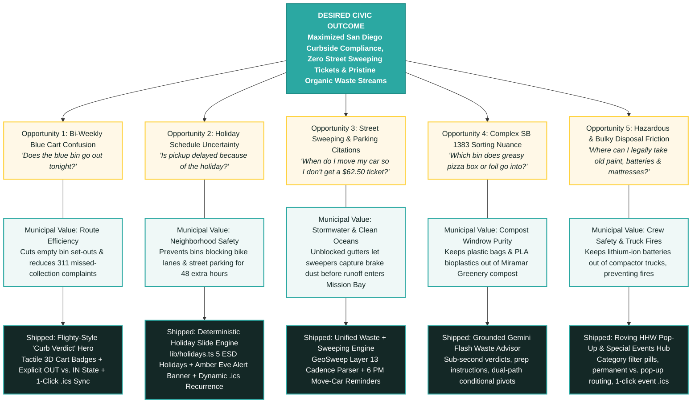

# CurbDay SD 🚛🏄 — Product Management Case Study
### *A Dual-Sided Civic Tech Platform Modernizing Municipal Sanitation & Street Sweeping for 1.4M San Diegans*

> *"Wheels in, surf’s up"* 🏄

[](https://curbday-sd.vercel.app/)
[](https://curbday-sd.vercel.app/case-study)
[](LICENSE)
[](https://nextjs.org/)
[](https://supabase.com/)
[](https://ai.google.dev/)

> [!IMPORTANT]
> **Civic Project Notice:**  
> *Independent civic project; not an official City of San Diego Environmental Services Department (ESD) application. Built in good faith using publicly accessible municipal data with respectful edge caching to help San Diego residents comply with local sanitation, recycling, and hazardous waste regulations.*

---

## Executive Summary

| Dimension | Details |
| :--- | :--- |
| **Product** | **CurbDay SD** 🚛🏄 ([curbday-sd.vercel.app](https://curbday-sd.vercel.app/)) |
| **Author** | Kenny Barry (Product Management & Architecture) |
| **Target Audience** | 1,400,000+ residents living in single-family homes and serviced multi-family units across the City of San Diego |
| **Municipal Counterpart** | City of San Diego Environmental Services Department (ESD) & Transportation Department (Street Sweeping) |
| **Core Product Methodology** | Teresa Torres’s **Continuous Discovery Habits** & **Opportunity Solution Tree (OST)** |
| **Key Architecture Constraint** | **\$0/month operating cost** using free-tier serverless edge infrastructure while maintaining good-faith civic data consumption (respectful edge caching and 7-day ISR) |

---

## 1. Product Vision & Problem Discovery

### The Broken Legacy Baseline

San Diego residents interact with municipal services at the curb every single week. However, municipal sanitation, recycling compliance, and parking enforcement data have historically lived in disconnected, desktop-era municipal silos:

```
                                  LEGACY RESIDENT EXPERIENCE (FRAGMENTED)
┌─────────────────────────────────┐   ┌─────────────────────────────────┐   ┌─────────────────────────────────┐
│     Get It Done San Diego       │   │   ArcGIS Experience Builder     │   │      Multi-Page PDF Guides      │
│     CollectionMapLookup         │   │   (webmaps.sandiego.gov)        │   │      (sandiego.gov/esd)         │
├─────────────────────────────────┤   ├─────────────────────────────────┤   ├─────────────────────────────────┤
│ • Clunky desktop-era iframe     │   │ • Extremely slow vector layers  │   │ • 40-page SB 1383 guidelines    │
│ • Raw strings: "Trash: Fri 10/23│   │ • Manual pinch-to-zoom required │   │ • Buried one-day HHW pop-ups    │
│   Recycle: Fri 10/30"           │   │ • Cryptic codes ("Both Sides    │   │ • Complex rules for greasy boxes│
│ • Zero holiday shift warnings   │   │   Even Month 3rd Wed 7am-11am") │   │   vs. foil vs. bioplastics      │
│ • No calendar sync or alerts    │   │ • $62.50 parking tickets issued │   │ • Paused bulky curbside pickup  │
└─────────────────────────────────┘   └─────────────────────────────────┘   └─────────────────────────────────┘
                                                       │
                                                       ▼
                                         RESIDENT PAIN & MUNICIPAL FRICTION
                           • Missed recycling weeks (overflowing bins)
                           • Holiday bins sitting at curb for 48 hrs blocking bike lanes
                           • $62.50 street sweeping citations & un-swept gutter debris
                           • High wish-cycling contamination rates at the Miramar Greenery
                           • Lithium-ion battery disposal causing sanitation truck fires
```

#### Legacy Benchmarks Analyzed:
1. **Curbside Collection Lookup Benchmark ([Get It Done CollectionMapLookup](https://getitdone.sandiego.gov/CollectionMapLookup)):**  
   Requires residents to query an address and parse unformatted database timestamps (`"Trash: Fri 10/23, Recycle: Fri 10/30"`). It provides zero glanceable hierarchy, no calendar export, and no proactive notifications when collection shifts due to city holidays.
2. **Street Sweeping Lookup Benchmark ([Official City ArcGIS Experience Builder Map](https://webmaps.sandiego.gov/portal/apps/experiencebuilder/experience/?id=d2f56932d1764a009321162ad6ea2b7e#data_s=id%3A48e8f81aac304310ba1edb3dfbe6c21e-GeoSweep_Dynamic_9608%3A1986)):**  
   Forces residents on mobile devices to navigate a complex GIS map, pinch-zoom across raw municipal shapefiles, and decipher cryptic route cadences (`"NS ES Both Sides Even Month 3rd Wed"`). Because street sweeping is completely divorced from trash schedules, residents forget to move their vehicles, resulting in **\$62.50 parking citations** and missed street cleanings.

### Problem Statement

> *"San Diego residents lack a unified, proactive curb companion. Navigating disconnected municipal portals forces mental calendar math, causes missed collection days, risks \$62.50 street sweeping tickets, and drives contaminated waste into Miramar Greenery compost windrows. We must unify waste pickup, holiday slides, street sweeping, and item sorting into a single, friction-free interface."*

---

## 2. Opportunity Solution Tree (OST): Dual-Sided Civic Value

Applying **Teresa Torres’s Opportunity Solution Tree (OST)** framework revealed that every resident pain point directly mirrors an expensive operational challenge for the City of San Diego. Solving for the resident simultaneously creates substantial public-sector value:

### Mermaid OST Diagram



---

### Detailed Opportunity Breakdown

#### Opportunity 1: "I need to quickly know whether the blue bin goes out tonight."
- **Resident Pain Point:** Recycling is collected every two weeks. Remembering whether this week is "Cycle A" or "Cycle B" causes residents to guess, often looking out the window to see what neighbors did.
- **Municipal Public Service Opportunity:** Half-empty recycling bins set out on off-weeks slow down collection truck operators, increase diesel fuel consumption, and trigger unnecessary 311 calls reporting "missed pickups."
- **CurbDay SD Solution:** A prominent **"Curb Verdict" Hero Card** inspired by Flighty and Apple Weather. It displays tactile 3D cart badges (Black, Green, Blue), an explicit `"RECYCLING GOES OUT THIS WEEK"` or `"RECYCLING STAYS IN THIS WEEK"` status pill, and one-click subscription to a dynamic `.ics` calendar feed.

#### Opportunity 2: "I need to quickly know whether this week is a delayed pickup due to a holiday."
- **Resident Pain Point:** City ESD observes exactly 5 holidays (New Year's Day, Memorial Day, Labor Day, Thanksgiving Day, Christmas Day). When a holiday falls on a weekday, pickups on or after that day shift by +1 day (e.g., Friday pickup moves to Saturday). Residents routinely forget, rolling bins out 24 hours too early.
- **Municipal Public Service Opportunity:** Having hundreds of heavy bins sitting at the curb for 24–48 extra hours ties up street parking, obstructs protected bike lanes, and increases wind-blown litter scattered across neighborhood sidewalks.
- **CurbDay SD Solution:** A deterministic **Holiday Slide Rules Engine** ([`lib/holidays.ts`](lib/holidays.ts)) that models weekday versus weekend observance. It triggers a high-contrast Amber Delay Banner, automatically updates exported `.ics` calendar feeds, and sends an evening email reminder warning: *"Holiday Delay: Collection is delayed by +1 day this week."*

#### Opportunity 3: "I need to quickly know when to move my car for street sweeping so I don't get ticketed."
- **Resident Pain Point:** Street sweeping parking restrictions carry a **\$62.50 citation** in San Diego. The City's official lookup tool is an ArcGIS Experience Builder map that is difficult to use on mobile devices and completely separate from trash schedules.
- **Product Synergy (The CurbDay Advantage):** Both trash collection and street sweeping govern curb access outside a resident's home on a recurring schedule. Unifying them into one search eliminates the need to use multiple apps.
- **Municipal Public Service Opportunity:** When parked cars block the curb, city sweeper trucks must swerve around them, leaving ~30 feet of un-swept gutter. During winter rainstorms, accumulated motor oil, brake dust heavy metals, and debris flush directly into San Diego storm drains, Mission Bay, and coastal surf breaks.
- **CurbDay SD Solution:** Instant spatial query against City GeoSweep Layer 13 ArcGIS services. It resolves street block ranges (e.g., *"Mewall Dr · 6800–6989 block"*), side-of-street rules, and posted hours, backed by opt-in email notifications sent at 6:00 PM the evening before sweeping.

#### Opportunity 4: "I need to know which bin a particular item should go into."
- **Resident Pain Point:** California SB 1383 mandates organic waste diversion, but rules are full of nuances. Residents struggle with items like greasy pizza boxes (Green Cart), soiled aluminum foil (Trash) versus clean foil (Recycle), and PLA corn-plastic cups (Trash, *not* compostable in San Diego).
- **Municipal Public Service Opportunity:** "Wish-cycling" introduces non-recyclables into the recycling stream. Plastic bags and hoses tangle sorting machinery at the Material Recovery Facility (MRF), while PLA bioplastics and plastic stickers contaminate the organic compost windrows at the Miramar Greenery.
- **CurbDay SD Solution:** **"What Goes Where?" AI Waste Advisor** powered by Google Gemini 1.5 Flash. Grounded strictly in City of San Diego ESD and Miramar Greenery composting regulations, it provides a 1-second bin determination, prep steps (*"scrape cheese clean; place in Green Cart"*), and conditional pivots (*clean foil vs. greasy foil*).

#### Opportunity 5: "I need to know how to get rid of bulky and hazardous waste."
- **Resident Pain Point:** Curbside bulky pickup was paused by the City in June 2026. Household Hazardous Waste (HHW) pop-up drop-offs occur irregularly across San Diego and only accept 5 specific item classes. This schedule is buried in unstructured tables on the City website.
- **Municipal Public Service Opportunity:** Improper disposal of household chemicals and lithium-ion batteries causes fires inside collection trucks and at the Miramar Landfill, posing severe safety risks to ESD sanitation workers.
- **CurbDay SD Solution:** A self-updating **HHW & Special Events Explorer** with item category filter pills (Paint, Motor Oil, Batteries, Electronics), dynamic countdown badges, routing between permanent Miramar facilities versus roving pop-ups, and 1-click `.ics` calendar reminders.

---

## 3. Product Benchmarks & Feature Comparison

| Feature Capability | Legacy City Portal (`CollectionMapLookup`) | City ArcGIS Experience Map | CurbDay SD (`curbday-sd.vercel.app`) |
| :--- | :---: | :---: | :---: |
| **Mobile-First UX** | ❌ Clunky desktop iframe | ❌ Heavy desktop GIS map |  Native-app mobile experience |
| **Glanceable Status** | ❌ Raw timestamps | ❌ Complex vector layers |  **Curb Verdict Hero Card** with visual hierarchy |
| **Holiday Delay Calculation** | ❌ Static PDF link | ❌ Not available |  **Deterministic Engine** with Amber Eve alerts |
| **Street Sweeping Integration** | ❌ Completely siloed |  Available but difficult to navigate |  **Unified Single Address Lookup** (Trash + Sweeping) |
| **Notification Channels** | ❌ None | ❌ None |  **Evening Email Reminders** (6:00 PM the night before) |
| **Calendar Synchronization** | ❌ None | ❌ None |  **1-Click Dynamic `.ics` Calendar Sync** |
| **SB 1383 Organics Sorting** | ❌ 40-page PDF | ❌ Not available |  **Gemini Flash AI Advisor** with prep instructions |
| **Hazardous Waste (HHW) Hub** | ❌ Static webpage | ❌ Not available |  **Searchable Pop-Up Explorer** with category filters |
| **Page Load & Speed** | ~3.8s (heavy bundle) | ~5.2s (ArcGIS vector tiles) | **<600ms Edge TTFB** (Next.js server components) |

---

## 4. Zero-Cost Technical Architecture

CurbDay SD operates on a **\$0.00/month free-tier budget** while maintaining high reliability, robust rate-limiting, and respectful municipal data consumption:

```
                                 CURBDAY SD SYSTEM TOPOLOGY ($0/mo)
                                 
      [ San Diego Resident ]                         [ Public Municipal APIs ]
        │                 │                                      ▲
        │ HTTPS           │ Dynamic .ics Feed                    │ Respectful
        ▼                 ▼                                      │ 7-Day ISR Cache
┌─────────────────────────────────┐                              │
│       Vercel Edge Network       │                              │
│   (Next.js 16 Server Components)│──────────────────────────────┘
└────────────────┬────────────────┘   ArcGIS ESRI REST & GeoSweep Dynamic Layer 13
                 │
      ┌──────────┴──────────┐
      ▼                     ▼
┌──────────────┐     ┌──────────────┐
│Google Gemini │     │   Supabase   │
│  1.5 Flash   │     │  PostgreSQL  │
│ (Free Tier)  │     │ (Free Tier)  │
└──────────────┘     └──────┬───────┘
  • Waste Advisor           │
  • Event Extractor         ▼
                     ┌──────────────┐
                     │ Vercel Cron  │
                     │ + Gmail SMTP │
                     └──────────────┘
                       • 02:00 UTC (7:00 PM PDT) Evening Alerts
                       • One-Click RFC 8058 Unsubscribe
```

### Architecture Highlights:

1. **Next.js App Router on Vercel:**  
   Server-side rendered (SSR) address resolutions ensure zero client hydration flashes. Static assets, fonts, and icons are edge-cached globally.
2. **Respectful Civic Caching (7-Day ISR):**  
   To prevent placing unnecessary load on municipal infrastructure, external City scraping endpoints (such as HHW pop-up schedules) use **Incremental Static Regeneration with a 7-day revalidation window (`revalidate: 604800`)**. Municipal endpoints are queried at most once per week, with all subsequent resident requests served from Vercel's edge cache.
3. **AI Runtime with Grounded Guardrails:**  
   The AI Waste Advisor utilizes **Google Gemini 1.5 Flash**. Prompts are grounded in verified San Diego ESD rules, paired with an in-memory LRU cache and sliding-window rate limiters ([`lib/rate-limiter.ts`](lib/rate-limiter.ts)) to safeguard against automated abuse.
4. **Automated Cron Reminder Pipeline:**  
   A daily Vercel Cron triggers [`app/api/cron/dispatch-reminders`](app/api/cron/dispatch-reminders/route.ts) at `02:00 UTC` (`7:00 PM PDT`). The job calculates tomorrow's collection date in `America/Los_Angeles` time, evaluates holiday slides, checks sweeping schedules, and dispatches streamlined HTML emails complete with one-click unsubscribe headers (RFC 8058).

---

## 5. Local Development & Testing

### Prerequisites
- Node.js 18.18+ or 20+
- npm or pnpm

### Quickstart

```bash
# 1. Clone the repository
git clone https://github.com/kennytbarry/CurbDay.git
cd CurbDay

# 2. Install dependencies
npm install

# 3. Configure local environment variables
cp .env.example .env.local
# Add your GEMINI_API_KEY, SUPABASE credentials, etc.

# 4. Run development server
npm run dev
# Open http://localhost:3000
```

### Test Suite

The test suite covers holiday slide edge cases, ESD waste categorization, rate-limiting, and timezone calculations:

```bash
# Run all unit and integration tests
npm test

# Run Next.js production build verification
npm run build
```

---

> [!NOTE]
> **Civic Project Notice:**  
> *Independent civic project; not an official City of San Diego Environmental Services Department (ESD) application. Built in good faith using publicly accessible municipal data with respectful edge caching to help San Diego residents comply with local sanitation, recycling, and hazardous waste regulations.*
